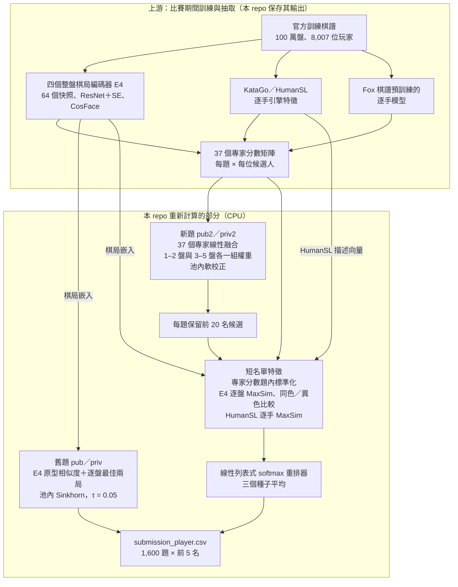

# AI CUP 2026 圍棋競賽｜從棋譜辨識玩家

給定一位匿名玩家的幾盤 19 路圍棋棋譜，從候選庫找出最可能是他的五位玩家。最終方法分三層：
1. 用整盤棋局表徵產生多個專家分數；
2. 把 37 個專家分數線性融合；
3. 對融合後的前 20 名候選做列表式重排。

| 隊伍 | Private 分數 | Private 名次 | Public 分數 |
|---|---:|---:|---:|
| TEAM_10893 | **0.8985554** | **第 11 名／136 隊** | 0.8853318 |

本 repo 可從保存的模型產物重新算出比賽提交檔，並與原檔逐位元比對（SHA-256 `027f7ad8…b91459`）。步驟見[重現提交檔](#重現提交檔)。

## 目錄

- [任務](#任務)
- [方法總覽](#方法總覽)
- [開發歷程](#開發歷程)
- [驗證與選檔](#驗證與選檔)
- [重現提交檔](#重現提交檔)
- [重現範圍](#重現範圍)
- [Repo 結構](#repo-結構)
- [資料與外部資源](#資料與外部資源)
- [授權](#授權)

## 任務

AI CUP 2026 圍棋競賽的子任務一。
- **資料**：日本棋院幽玄之間 2021–2023 年的匿名棋譜。訓練集共 100 萬盤、8,007 位玩家。
- **題目**：每題給一位玩家的若干盤棋，在指定候選庫中依可能性排出五位玩家。
- **計分**：正解排第 r 名得 e^(1−r) 分，排第 6 名以後得 0 分。

| 題池 | 候選庫 | 每題查詢盤數 | 執色 |
|---|---|---|---|
| `pub_`、`priv_` | 400 位玩家，每人 100 盤 | 5、10、15、20 | 執黑 |
| `pub2_`、`priv2_` | 600 位玩家，每人 10 盤 | 1、2、3、5 | 黑白混合 |

四組題目各 400 題，共 1,600 題。Public 分數是 `pub_` 與 `pub2_` 兩組的平均，Private 分數是 `priv_` 與 `priv2_` 兩組的平均。新題組的候選人只有 10 盤參考棋譜，查詢最少只有 1 盤，是主要難點。

## 方法總覽



1. **棋局表徵（E4）**：每盤棋取目標玩家的 64 個快照，均勻分布在整盤。每個快照用寬度 128 或 192、10 個 SE block 的 ResNet 編碼成 256 維向量，以 CosFace 做單盤玩家分類。兩種寬度各訓練兩個種子，串接成 E4 嵌入。
2. **舊題（pub／priv）**：候選人有 100 盤參考棋譜，資訊充足。用 E4 的原型餘弦與逐盤最佳兩局相似度計分，在候選池內做 Sinkhorn 校正後取前五名。
3. **新題的專家融合**：
   - 基準分數加上 36 個專家分支，依查詢盤數（1–2 盤／3–5 盤）採用兩組權重。
   - 專家分支涵蓋棋局集合比對、逐手決策、Fox 預訓練、KataGo／HumanSL 引擎與開局等類別。
   - 融合後在池內做軟校正，每題保留前 20 名候選。
4. **短名單重排**：
   - 每位候選人的特徵包括：專家分數在短名單內的標準化值、融合分數、E4 逐盤最大相似度、同色與異色比較、HumanSL 逐手最大相似度。
   - 只在短名單內比較，可以減少不同題池分數尺度不一致的影響。
   - 用八個本地標註題池（共 3,200 題）訓練線性列表式 softmax，三個種子的 logits 取平均。

各步驟的參數、37 個專家的權重和特徵定義見 [docs/method.md](docs/method.md)。

## 開發歷程

| 時間 | 做法 | Public |
|---|---|---:|
| 11/11 | 24 個快照的全量 ResNet 基準 | 0.5883330 |
| 11/11–13 | 白化、分色與集合距離校正；開局與全盤兩分支、短題訓練 | 0.6592951 → 0.6682547 |
| 11/13 | **整盤 64 快照＋大型 ResNet＋CosFace，加上池內 Sinkhorn** | **0.8047551** |
| 11/13–16 | 加入寬度 192 模型、引擎度量與第二組種子，形成 E4 嵌入集成 | 0.806 → 0.8126303 |
| 11/19 | **37 個專家的線性融合**（逐手、Fox、引擎搜尋、HumanSL、開局等） | **0.8685411** |
| 11/20 | **前 20 名短名單的列表式重排（最終提交）** | **0.8853318** |
| 11/20–23 | 新骨幹 SnapTrans、多底稿集成、重排後再做 Sinkhorn，Public 都略低於最終版 | 0.8811489–0.8846826 |

三次大幅進步都來自「看得更多、比得更細」：
- 第一次是從部分棋局改成整盤表徵；
- 第二次是加入多種互補的專家訊號；
- 第三次是在短名單內做逐盤、逐手的細部比對。

完整的 20 次上傳紀錄、有效與無效的方法，見 [docs/experiments.md](docs/experiments.md)。

## 驗證與選檔

- **本地題池**：
  - 依玩家切分訓練與驗證，避免同一位玩家同時出現在兩邊。
  - 用歷史題池與引擎特徵完整的題池模擬新題型；重排器用八個題池輪流留一池評估。
- **跨池盲測**：把官方候選庫中身分已知的參考棋譜拆成參考與代理查詢，檢查方法換到不同候選池後是否仍然有效。
- **為何選最終版**：
  - 最終版的 Public 比 37 專家融合版高 **+0.0168**。舊題答案不變，換算成新題組約 **+0.0336**。
  - 新骨幹版的 Public 和最終版只差約半題，單看 Public 分不出高下。
  - 選檔時把本地成對差值和 Public 差值放在同一尺度，用經驗貝氏方法和三種先驗檢查敏感度；新骨幹版勝過最終版的機率約 0.38–0.42。
  - 「重排後再做 Sinkhorn」在本地進步，Public 卻退步。原因是本地題池嚴格一題一人，官方新題允許同一位玩家出多題，所以本地會高估這類「容量限制」的效果。

## 重現提交檔

在 Windows 11、Python 3.11.16、只用 CPU 的環境測試過，從乾淨的 clone 開始，結果與比賽提交檔逐位元相同。

### 1. 取得程式與環境

```shell
git clone https://github.com/leezr2002/aicup2026-go-player-identification.git
cd aicup2026-go-player-identification
conda env create -f environment.yml
conda activate aicup-go-final
```

### 2. 放入官方競賽資料

本 repo 不散布競賽資料。請把官方提供的 9 個檔案放進 `data/official/player_identification/`。檔名和 SHA-256 列在 [data/README.md](data/README.md)。程式執行時會核對雜湊，和比賽使用的版本不同時會停止。

### 3. 下載模型產物並驗收

```shell
python download_artifacts.py
python -B acceptance.py
```

- `download_artifacts.py` 從本 repo 的 [GitHub Release](https://github.com/leezr2002/aicup2026-go-player-identification/releases/tag/v1.0) 下載推論用產物（452 MiB 壓縮檔），解壓後逐檔核對 SHA-256。
  - 也可以手動下載 zip，再用 `--from-dir <資料夾>` 指定位置。
- `acceptance.py` 分兩個獨立程序執行：先重新推論，再驗證輸出。
  - 推論程序禁止讀取 repo 以外的檔案，也禁止讀取原始提交檔。
  - 驗證程序檢查表頭、題號順序、每題五個候選人是否屬於對應候選庫，最後與 `player_identification/submission/submission_player.csv` 逐列、逐位元比對。

預期輸出（測試機約 12 分鐘，記憶體峰值約 1.6 GB）：

```text
Prepared pub2
Prepared priv2
Wrote 1600 predictions to outputs/submission_player.csv
submission_player.csv: 1600/1600 rows and SHA-256 match (027f7ad8ff2483a96ee051ae0537241101846de90f96ed1683e7d3de86b91459)
```

### 選用：重訓重排器

```shell
python download_artifacts.py --bundle inference training
python -B player_identification/scripts/train.py
python -B acceptance.py --trained
```

用保存的八個本地題池重新訓練三個種子的重排器，再用新權重驗收。亂數種子固定，測試機重訓約 2 分鐘，記憶體峰值約 2.5 GB；重訓後的提交檔仍與原檔逐位元相同。

### 選用：從官方棋譜重建 E4 嵌入

需要支援 BF16 的 NVIDIA CUDA GPU。

```shell
python download_artifacts.py --bundle inference encoders
python -B player_identification/scripts/prepare.py --encode-sgf
python -B player_identification/scripts/predict.py --rebuilt-embeddings
python -B player_identification/scripts/verify.py
```

用隨附的四個編碼器權重，從官方 SGF 重新產生四個題池的 E4 嵌入，再用新嵌入推論。這條流程不在本次發布的逐位元驗收範圍內；GPU 的 BF16 運算可能讓嵌入有極小的數值差異。

## 重現範圍

- **逐位元重現**：從保存的上游輸出開始，包括 37 個專家分數矩陣、E4 棋局嵌入和 HumanSL 描述向量。之後的舊題計分、新題融合、短名單特徵、重排與輸出全部重新計算。
- **可重訓**：短名單重排器（CPU，幾分鐘）。E4 編碼器的訓練程式也在 repo 內，執行 `python player_identification/scripts/train.py --encoders`，需要官方訓練集、約 12 GB 快取和 CUDA。
- **不在本 repo 範圍**：36 個上游專家分支的訓練程式與完整重訓。這些模型在比賽期間由大量實驗產生，本 repo 只保存它們對比賽題目和本地題池的輸出，所以無法對任意新題目做端到端推論。

## Repo 結構

```text
.
├── README.md
├── environment.yml               Python 3.11 與套件版本
├── acceptance.py                 一鍵重新推論並驗收
├── verify_submission.py          格式、題號、候選庫與 SHA-256 檢查
├── download_artifacts.py         從 GitHub Release 下載並核對模型產物
├── data/
│   ├── README.md                 官方資料清單與 SHA-256、外部資源
│   └── official/player_identification/   放官方 CSV（不隨 repo 散布）
├── docs/
│   ├── method.md                 方法細節、37 個專家權重、特徵定義
│   └── experiments.md            20 次上傳紀錄、有效／無效方法
└── player_identification/
    ├── README.md                 各階段指令與輸入輸出
    ├── config/final.yaml         融合權重、重排超參數、官方輸入雜湊
    ├── src/                      題池、融合、短名單特徵、重排、E4 編碼器
    ├── scripts/                  prepare／train／predict／verify 入口
    ├── artifacts/
    │   ├── manifest.json         Release 產物清單與 SHA-256
    │   ├── weights/              比賽使用的重排器權重（3 個種子）
    │   └── ...                   由 download_artifacts.py 下載
    ├── submission/submission_player.csv   比賽提交原檔
    └── outputs/                  執行時產生（不進版本控制）
```

## 資料與外部資源

**官方資料**：由 AI CUP 2026 主辦單位提供，本 repo 不重新散布。

**Release 產物**：共三個壓縮檔。

| 壓縮檔 | 大小 | 用途 |
|---|---:|---|
| `player-artifacts-inference.zip` | 452 MiB | 必要，重現提交檔 |
| `player-artifacts-training.zip` | 1,050 MiB | 選用，重訓重排器 |
| `player-artifacts-encoders.zip` | 107 MiB | 選用，從 SGF 重建 E4 嵌入 |

內容是模型對比賽題目與本地題池的輸出，包括專家分數矩陣、棋局嵌入、HumanSL 描述向量、本地題池定義與訓練集中繼資料（玩家代碼、執色、手數、段位），以及 E4 編碼器權重。不含任何棋譜內容。

**外部資源**：比賽期間使用以下資源，依競賽規則揭露。

| 資源與版本 | 授權 | 用途 |
|---|---|---|
| KataGo v1.18.2（CUDA 13.2、cuDNN 9.24） | 引擎主體為 [MIT](https://github.com/lightvector/KataGo/blob/v1.18.2/LICENSE)，第三方元件依各自授權 | 局面分析、策略與搜尋特徵 |
| KataGo 權重 `kata1-tf3-b11c768-s11001M-d5973M`、HumanSL 權重 `b18c384nbt-humanv0` | [KataGo Neural Network License](https://katagotraining.org/network_license/)（[模型清單](https://katagotraining.org/networks/)、[HumanSL 發布頁](https://github.com/lightvector/KataGo/releases/tag/v1.15.0)） | 引擎專家分數，以及重排用的 HumanSL 逐手相似度 |
| Fox 圍棋棋譜 [`featurecat/go-dataset`](https://github.com/featurecat/go-dataset/tree/acace506d745d02f35a32249317c15cea28c66a6)，commit `acace506` | 上游資料庫標示 [GPL-3.0](https://github.com/featurecat/go-dataset/blob/master/LICENSE.txt) | 逐手棋風表徵的預訓練與融合專家 |

本 repo 不包含 KataGo 程式、權重或 Fox 棋譜。Release 產物中有一部分是用上述資源訓練或抽取的模型輸出。

## 授權

本 repo 未附開源授權，保留所有權利。歡迎閱讀程式碼，並依上述步驟驗證比賽結果；其他用途請先取得作者同意。第三方資源依各自的授權條款。
